# AWS Lab05 · Infrastructure Automation & Recovery Testing

**Boto3 provisioning · pytest validation · EC2 + ALB + Auto Scaling + S3**

A two-tier file-sharing application provisioned with Python and validated with unit, integration, and recovery tests. The uploader writes a text file to a private S3 bucket; the viewer reads the same object through a separate application tier.

[Architecture](#architecture) · [Setup](#setup-on-windows) · [Testing](#testing) · [Assignment answers](#assignment-answers) · [Results](#recorded-results) · [Screenshots](#screenshot-evidence) · [Cleanup](#cleanup)

## What this lab demonstrates

- Replace shell-based infrastructure workflows with modular Boto3 code.
- Give each EC2 application tier its own IAM role and instance profile.
- Route traffic through an Application Load Balancer and separate target groups.
- Replace failed instances with Auto Scaling Groups and measure recovery time.
- Test configuration, IAM policies, bootstrap scripts, and resource lifecycle using pytest and Moto.

## Architecture

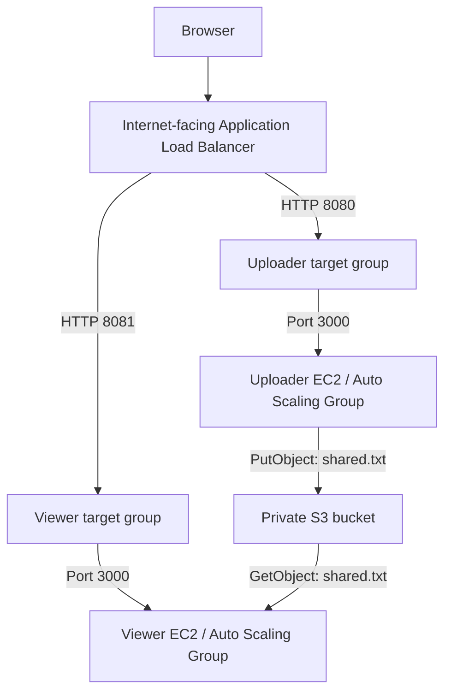

The ALB spans subnets in two Availability Zones in the default VPC. Each tier has **one instance** (`min = desired = max = 1`) and uses ELB health checks. This supports automatic replacement, with an outage during recovery; it does not provide continuous availability through redundant instances per tier.

| Component | Behavior |
| --- | --- |
| Uploader | Accepts `.txt` files with `text/plain` MIME type, up to 1,048,576 bytes; overwrites `shared.txt` |
| Viewer | Displays the contents of `shared.txt`, or a message when no file can be read |
| IAM | Uploader: `s3:PutObject` on the shared object; viewer: `s3:GetObject` on the object and `s3:ListBucket` |
| S3 | All four public-access block settings enabled |
| Networking | Stack setup replaces the app security group's world-open port 3000 rule with access from the ALB security group |
| EC2 bootstrap | Embeds application files, installs Node.js with `dnf`, and starts a systemd service |

## Repository guide

```text
.
├── create_stack.py          # Provision the AWS stack
├── delete_stack.py          # Tear down the AWS stack
├── stack/                   # Configuration and Boto3 resource modules
├── uploader-app/            # Express upload app
├── viewer-app/              # Express viewer app
├── tests/
│   ├── unit/                # Local tests, including Moto resource simulation
│   └── integration/         # Live AWS tests and chaos recovery tests
├── testing/                 # Additional probe and chaos helpers
├── lab03/                   # Retained earlier application copies
├── create_app_stack.sh      # Retained shell workflow
├── delete_app_stack.sh      # Retained shell cleanup workflow
├── docs/screenshots/        # All 12 supplied screenshots
├── .env.example             # Configuration template with placeholders
├── pytest.ini               # Default excludes integration and chaos tests
└── requirements.txt
```

## Setup on Windows

Use Python 3.10 or newer (the supplied evidence uses Python 3.12), an AWS CLI/profile configured for your lab account, and permissions to manage the resources used here.

From the repository root in PowerShell:

```powershell
python -m venv .venv
.\.venv\Scripts\python.exe -m pip install -r requirements.txt
Copy-Item .env.example .env
```

Edit `.env` before deployment. Replace the AMI, key pair, application security group, and bucket-name placeholders. Use an Amazon Linux 2023 AMI compatible with the instance type, an existing key pair and app security group in the selected region/default VPC, and default-VPC subnets in both configured Availability Zones. The instances need outbound access to install packages.

Keep AWS credentials in your AWS profile. The Python clients use Boto3's credential resolution; the Node.js applications use EC2 instance roles. Never put access keys in source files or screenshots.

## Testing

### 1. Run local unit tests

```powershell
.\.venv\Scripts\python.exe -m pytest -v
```

The default marker filter excludes live integration and chaos tests. Unit tests use fake settings and Moto where AWS simulation is needed.

### 2. Deploy and run integration tests

These commands create billable AWS resources. Integration tests upload test content and replace the shared object.

```powershell
.\.venv\Scripts\python.exe create_stack.py
# Allow the application targets to become healthy.
.\.venv\Scripts\python.exe -m pytest -o "addopts=" -m integration -v
```

Deployment prints uploader and viewer URLs and writes local `stack_outputs.json` and `stack_outputs.env` files. Keep those generated files out of Git. The sample listener ports are 8080 and 8081; both apps listen on port 3000 inside EC2.

### 3. Measure recovery

```powershell
.\.venv\Scripts\python.exe -m pytest -o "addopts=" -m chaos -s
```

The chaos tests terminate a real in-service instance without reducing desired capacity, observe an outage, and measure recovery against `RECOVERY_SLO_SECONDS`. Run only against your deployed lab stack.

## Assignment answers

### Question 1: What did Moto prove, what could it not prove, and which tests covered the gap?

Moto let me run the real create and delete code against a fake AWS environment. It checked that the code built the expected resources, handled repeated setup and cleanup, and applied the expected settings; other unit tests checked configuration, policies, and startup scripts. Moto could not show that a real EC2 instance would start the apps, that AWS would enforce every permission, or how long recovery would take. The 14 passing integration tests checked the deployed resources and app behavior, including uploading a file and reading it through the viewer; the IAM checks used AWS's policy simulator rather than trying every denied action from an instance. The 2 chaos tests checked recovery on real AWS: both passed the 180-second target, at about 69.42 seconds for the uploader and 73.64 seconds for the viewer, but a separate run failed the 60-second target.

### Question 2: Compare `ignore_errors("EntityAlreadyExists")` with `2>/dev/null || true`.

In Bash, `2>/dev/null || true` hides error messages and makes a failed command appear successful, so it can hide permission problems and typos too. In Python, `ignore_errors("EntityAlreadyExists")` ignores only that expected AWS error and lets other errors stop the script. This is useful when setup finds a resource that already exists: the script can continue without hiding an unrelated problem. The rest of the setup code still needs to check or update the resource's settings before we can call the whole operation safe to repeat.

### Question 3: Challenge 5 - Where was Bash shorter, and what did the extra Python lines provide? (Two sentences)

The bucket-exists check using `aws s3api head-bucket` in my Bash script was shorter than the Boto3 version in `stack/storage.py`. The extra Python lines check the AWS error code, so the code creates a bucket only when it is missing and leaves other errors, such as access denied, visible and easier to debug.

### Part J challenges 1-4: status

These are not claimed as completed. The current repo has no matching pair of launch-template tag tests (challenge 1), no unit test for `RECOVERY_SLO_SECONDS="fast"` with a friendly configuration error (challenge 2), no `--dry-run` flag (challenge 3), and no integration test for a world-open SSH port 22 rule (challenge 4). The existing port 3000 test does not cover the SSH challenge. A daily SSH drift test would help a team notice when someone opens SSH access to everyone, but that is an explanation of its value, not a completed experiment.

## Recorded results

These are historical results visible in the supplied screenshots, not claims that live AWS tests were rerun for this documentation update.

| Check | Recorded outcome |
| --- | --- |
| Initial policy test | 1 failed, 18 passed: uploader policy used `s3:*` instead of `s3:PutObject` |
| Final unit tests | **19 passed**, 16 deselected |
| Integration tests | **14 passed**, 21 deselected |
| Recovery with 180-second SLO | **2 passed**; uploader about 69.42 s, viewer about 73.64 s |
| Recovery with 60-second SLO | **2 failed**; uploader about 83.45 s, viewer about 80.31 s |
| Cleanup | Cleanup completed; subsequent checks show no ALBs, ASGs, or matching active/stopped lab EC2 instances |

The passing 180-second experiment demonstrates recovery within that target for the recorded run. The failed 60-second experiment shows that the stricter target was not met. The current uploader policy in `stack/policies.py` grants `s3:PutObject` on `shared.txt`.

## Screenshot evidence

All 12 supplied images are embedded below with repository-relative paths under `docs/screenshots/`. These are historical captures, not new AWS runs. Commands are transcribed from the captures unless the note explicitly says the command is outside the crop. Terminal wrapping is joined into runnable lines. The original suite has **19 unit, 14 integration, and 2 chaos tests** (35 total).

### 1. Original project directory

**Purpose:** Original project directory.

**Command:**

```powershell
Get-ChildItem -Force -Name
```

**Actual result:** Lists the project folders, apps, scripts, and local environment files.

**Explanation:** This shows the original working folder. Seeing a local .env or .venv name does not mean its contents are committed.

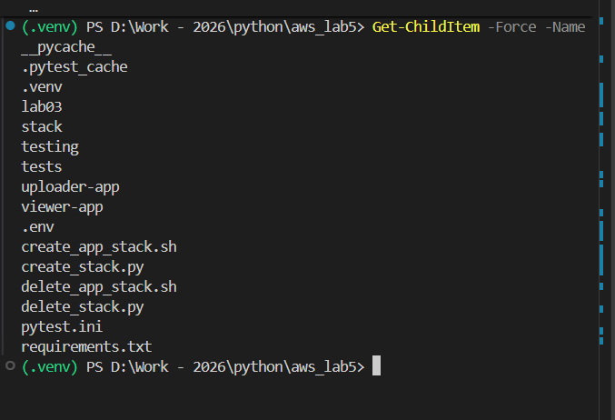

### 2. Detailed source and test layout

**Purpose:** Detailed source and test layout.

**Command:**

```powershell
Get-ChildItem stack, tests -Recurse -File |
  Where-Object { $_.FullName -notmatch '__pycache__' } |
  Select-Object -ExpandProperty FullName
```

**Actual result:** Lists the stack modules, shared test helpers, unit tests, integration tests, and recovery test file.

**Explanation:** This gives the folder-layout evidence in more detail and leaves cached Python files out of the listing.

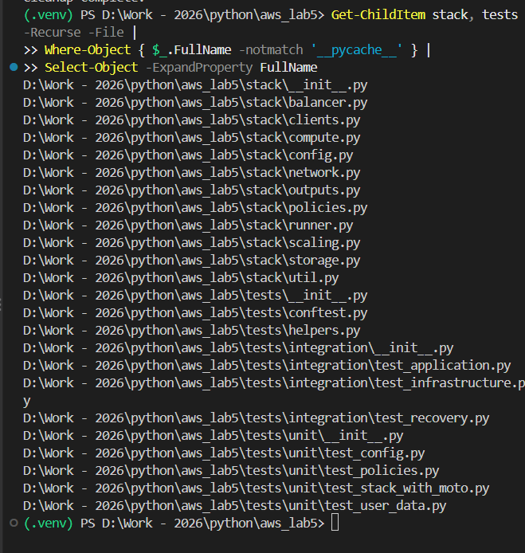

### 3. Policy test catches too much access

**Purpose:** Policy test catches too much access.

**Command:**

```powershell
python -m pytest -v
```

**Actual result:** 1 failed, 18 passed in 12.94 seconds. The failure compares s3:* with the expected s3:PutObject.

**Explanation:** The test catches an uploader policy that grants too much access. The screenshot includes the failing diff, but not a separate editor view of the changed source line requested by the break-it experiment checklist.

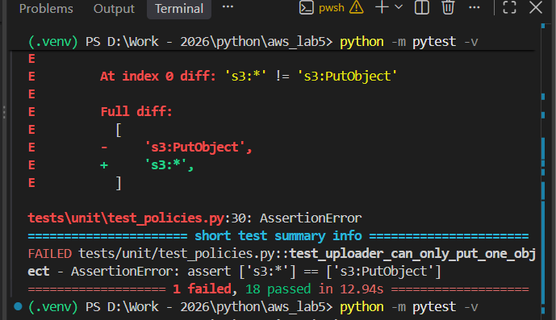

### 4. Final unit tests

**Purpose:** Final unit tests.

**Command:**

```powershell
python -m pytest -v
```

**Actual result:** 19 passed, 16 deselected in 21.69 seconds.

**Explanation:** The original unit suite passes after the policy is corrected. The command is supported by the earlier unit-run capture and workflow; this cropped image shows only the final output, not its command line.

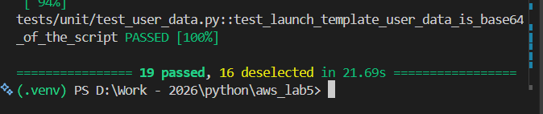

### 5. Stack creation

**Purpose:** Stack creation.

**Command:**

```powershell
python create_stack.py
```

**Actual result:** Setup reaches the end and prints both uploader and viewer URLs.

**Explanation:** The log shows bucket, IAM, launch template, network, load balancer, and Auto Scaling setup. Printing the URLs does not by itself prove the apps are ready; the integration tests check that.

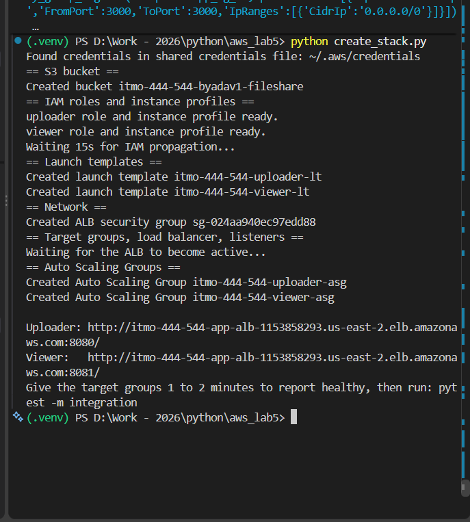

### 6. Integration tests

**Purpose:** Integration tests.

**Command:**

```powershell
python -m pytest -o "addopts=" -m integration -v
```

**Actual result:** 14 passed, 21 deselected in 6.22 seconds.

**Explanation:** These tests check the deployed infrastructure and app behavior, including the upload-to-viewer round trip. IAM permission decisions are checked through the policy simulator.

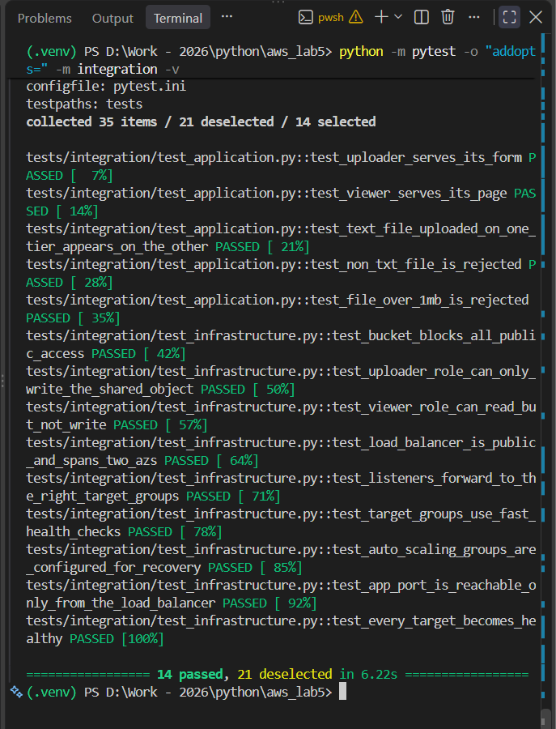

### 7. Recovery within 180 seconds

**Purpose:** Recovery within 180 seconds.

**Command:**

```powershell
python -m pytest -o "addopts=" -m chaos -s
```

**Actual result:** 2 passed, 33 deselected in 146.56 seconds. Uploader recovery: about 69.42 seconds; viewer recovery: about 73.64 seconds (SLO 180 seconds).

**Explanation:** Each test terminates an instance, observes an outage, and waits for the endpoint to return. Both tiers met the recorded target. The 14-pass line at the top is from an earlier integration run.

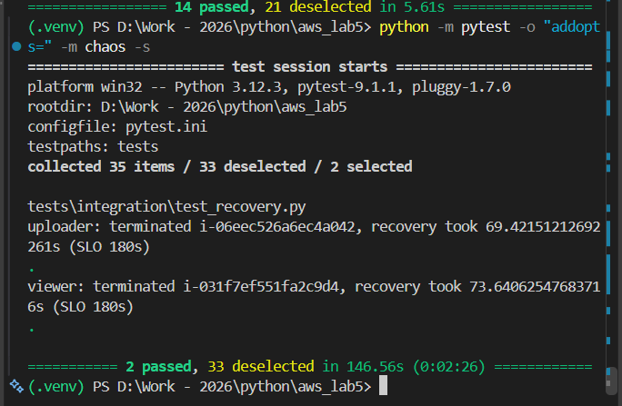

### 8. Recovery exceeds 60 seconds

**Purpose:** Recovery exceeds 60 seconds.

**Command:**

```powershell
python -m pytest -o "addopts=" -m chaos -s
```

**Actual result:** 2 failed, 33 deselected in 168.21 seconds. Uploader: about 83.45 seconds; viewer: about 80.31 seconds, each compared with 60.

**Explanation:** This separate run used a 60-second target. The endpoints recovered, but too slowly to pass that target. The screenshot does not show how the local setting was edited or restored.

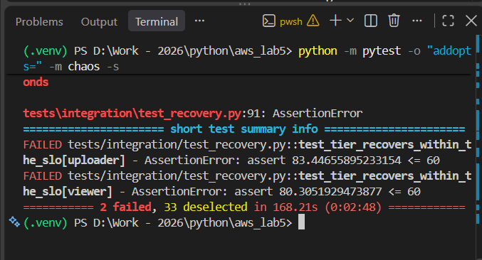

### 9. Original cleanup completion

**Purpose:** Original cleanup completion.

**Command:**

```powershell
python delete_stack.py
```

**Actual result:** The script ends with Cleanup complete.

**Explanation:** The cleanup log reaches the end of the resource-removal steps without a displayed error.

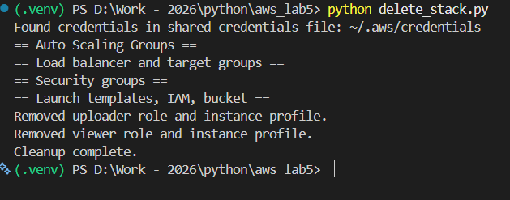

### 10. Cleanup run A

**Purpose:** Cleanup run A.

**Command:**

```powershell
python delete_stack.py
```

**Actual result:** The supplied first repeat-cleanup capture ends with Cleanup complete.

**Explanation:** This is one of the two saved cleanup runs used to show that cleanup can be repeated.

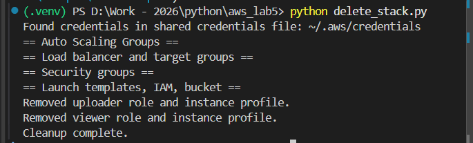

### 11. Cleanup run B

**Purpose:** Cleanup run B.

**Command:**

```powershell
python delete_stack.py
```

**Actual result:** The supplied second repeat-cleanup capture also ends with Cleanup complete.

**Explanation:** Running cleanup again finishes without a displayed missing-resource error. The filenames identify the two runs; the captures do not show timestamps.

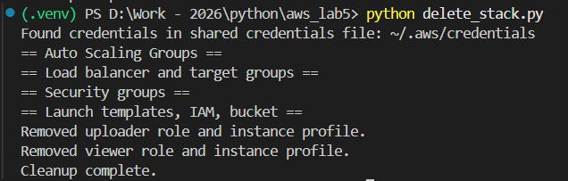

### 12. Post-cleanup resource checks

**Purpose:** Post-cleanup resource checks.

**Command:**

```powershell
python delete_stack.py
python -c "from stack.clients import AwsClients; a=AwsClients.create('us-east-2'); print('ALBs:', [x['LoadBalancerName'] for x in a.elbv2.describe_load_balancers()['LoadBalancers']]); print('ASGs:', [x['AutoScalingGroupName'] for x in a.autoscaling.describe_auto_scaling_groups()['AutoScalingGroups']]); print('Lab05 EC2 instances:', [(i['InstanceId'],i['State']['Name']) for r in a.ec2.describe_instances(Filters=[{'Name':'tag:Name','Values':['uploader-app','viewer-app']},{'Name':'instance-state-name','Values':['pending','running','stopping','stopped']}])['Reservations'] for i in r['Instances']])"
```

**Actual result:** ALBs: [], ASGs: [], Lab05 EC2 instances: [].

**Explanation:** No load balancers or Auto Scaling Groups are returned, and no instances with the two lab Name tags are returned in the four checked states in us-east-2. This check does not list every AWS service or region, and does not independently verify bucket or IAM removal.

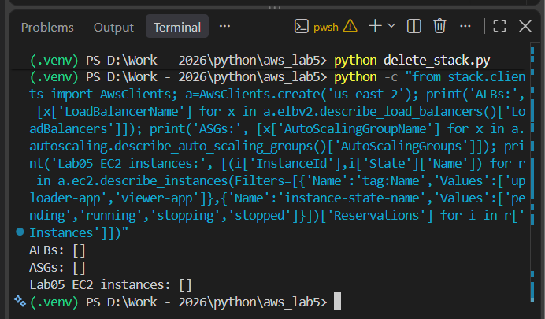

## Cleanup

```powershell
.\.venv\Scripts\python.exe delete_stack.py
```

The full cleanup removes the ASGs, ALB, target groups, ALB security group, launch templates, IAM roles/profiles, bucket contents, bucket, and local stack output files. It retains the existing default VPC, subnets, key pair, and application security group. The cleanup code restores world-open port 3000 on that application security group, so review its rules afterward.

To retain the bucket, IAM roles/profiles, and launch templates intentionally:

```powershell
.\.venv\Scripts\python.exe delete_stack.py --keep-foundation
```

## Repository hygiene

`.gitignore` excludes `.env`, virtual environments, AWS credential directories, private-key files, caches, dependency folders, and generated stack outputs. `.env.example` contains placeholders only. Backup files and archives are excluded too. Original source files and screenshot originals are preserved; the documentation uses copies under `docs/screenshots/`.
