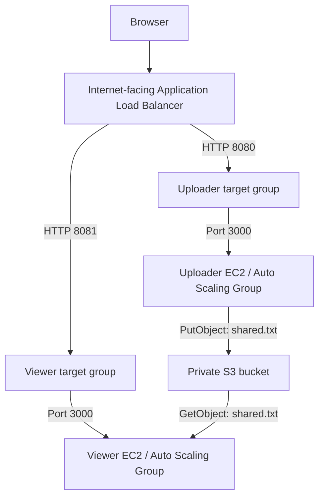

# AWS Lab05 · Infrastructure Automation & Recovery Testing

**Boto3 provisioning · pytest validation · EC2 + ALB + Auto Scaling + S3**

A two-tier file-sharing application provisioned with Python and validated with unit, integration, and recovery tests. The uploader writes a text file to a private S3 bucket; the viewer reads the same object through a separate application tier.

[Architecture](#architecture) · [Setup](#setup-on-windows) · [Testing](#testing) · [Assignment answers](#assignment-answers) · [Results](#recorded-results) · [Screenshots](#screenshot-evidence) · [Cleanup](#cleanup)

## What this lab demonstrates

- Replace shell-based infrastructure workflows with modular Boto3 code.
- Give each EC2 application tier its own IAM role and instance profile.
- Route traffic through an Application Load Balancer and separate target groups.
- Replace failed instances with Auto Scaling Groups and measure recovery time.
- Test configuration, IAM policies, bootstrap scripts, and resource lifecycle using pytest and Moto.

## Architecture



The ALB spans subnets in two Availability Zones in the default VPC. Each tier has **one instance** (`min = desired = max = 1`) and uses ELB health checks. This supports automatic replacement, with an outage during recovery; it does not provide continuous availability through redundant instances per tier.

| Component | Behavior |
| --- | --- |
| Uploader | Accepts `.txt` files with `text/plain` MIME type, up to 1,048,576 bytes; overwrites `shared.txt` |
| Viewer | Displays the contents of `shared.txt`, or a message when no file can be read |
| IAM | Uploader: `s3:PutObject` on the shared object; viewer: `s3:GetObject` on the object and `s3:ListBucket` |
| S3 | All four public-access block settings enabled |
| Networking | Stack setup replaces the app security group's world-open port 3000 rule with access from the ALB security group |
| EC2 bootstrap | Embeds application files, installs Node.js with `dnf`, and starts a systemd service |

## Repository guide

```text
.
├── create_stack.py          # Provision the AWS stack
├── delete_stack.py          # Tear down the AWS stack
├── stack/                   # Configuration and Boto3 resource modules
├── uploader-app/            # Express upload app
├── viewer-app/              # Express viewer app
├── tests/
│   ├── unit/                # Local tests, including Moto resource simulation
│   └── integration/         # Live AWS tests and chaos recovery tests
├── testing/                 # Additional probe and chaos helpers
├── lab03/                   # Retained earlier application copies
├── create_app_stack.sh      # Retained shell workflow
├── delete_app_stack.sh      # Retained shell cleanup workflow
├── docs/screenshots/        # All nine supplied screenshots
├── .env.example             # Configuration template with placeholders
├── pytest.ini               # Default excludes integration and chaos tests
└── requirements.txt
```

## Setup on Windows

Use Python 3.10 or newer (the supplied evidence uses Python 3.12), an AWS CLI/profile configured for your lab account, and permissions to manage the resources used here.

From the repository root in PowerShell:

```powershell
python -m venv .venv
.\.venv\Scripts\python.exe -m pip install -r requirements.txt
Copy-Item .env.example .env
```

Edit `.env` before deployment. Replace the AMI, key pair, application security group, and bucket-name placeholders. Use an Amazon Linux 2023 AMI compatible with the instance type, an existing key pair and app security group in the selected region/default VPC, and default-VPC subnets in both configured Availability Zones. The instances need outbound access to install packages.

Keep AWS credentials in your AWS profile. The Python clients use Boto3's credential resolution; the Node.js applications use EC2 instance roles. Never put access keys in source files or screenshots.

## Testing

### 1. Run local unit tests

```powershell
.\.venv\Scripts\python.exe -m pytest -v
```

The default marker filter excludes live integration and chaos tests. Unit tests use fake settings and Moto where AWS simulation is needed.

### 2. Deploy and run integration tests

These commands create billable AWS resources. Integration tests upload test content and replace the shared object.

```powershell
.\.venv\Scripts\python.exe create_stack.py
# Allow the application targets to become healthy.
.\.venv\Scripts\python.exe -m pytest -o "addopts=" -m integration -v
```

Deployment prints uploader and viewer URLs and writes local `stack_outputs.json` and `stack_outputs.env` files. Keep those generated files out of Git. The sample listener ports are 8080 and 8081; both apps listen on port 3000 inside EC2.

### 3. Measure recovery

```powershell
.\.venv\Scripts\python.exe -m pytest -o "addopts=" -m chaos -s
```

The chaos tests terminate a real in-service instance without reducing desired capacity, observe an outage, and measure recovery against `RECOVERY_SLO_SECONDS`. Run only against your deployed lab stack.

## Assignment answers

### Question 1: What did Moto prove, what could it not prove, and which tests covered the gap?

Moto allowed me to test my AWS infrastructure code without creating real AWS resources or incurring AWS resource charges. Using pytest with Moto, I verified that my Python code creates and deletes simulated S3 buckets, IAM roles, instance profiles, launch templates, Application Load Balancers, target groups, and Auto Scaling Groups. The unit suite also checked repeated creation and deletion, IAM policy documents, security group rules, configuration parsing, and application bootstrap scripts; not every unit test required Moto.

Moto could not prove actual EC2 startup, successful package installation, application availability, real IAM enforcement, or recovery timing in AWS. To cover these gaps, I ran 14 integration tests against the deployed stack and 2 chaos tests. The integration tests checked the real infrastructure configuration, target health, application endpoints, upload validation, and an upload-to-viewer round trip. IAM tests used AWS's policy simulator to evaluate allowed and denied actions; these checks complement the successful application operations, but do not directly exercise every denied operation using instance credentials.

All 14 integration tests passed. Both chaos tests passed with the 180-second SLO: the uploader recovered in approximately 69.42 seconds and the viewer in 73.64 seconds. A separate 60-second SLO experiment failed for both tiers, demonstrating that successful recovery does not necessarily meet a stricter recovery objective.

### Question 2: Compare `ignore_errors("EntityAlreadyExists")` with `2>/dev/null || true`.

In Bash, `2>/dev/null || true` discards a command's standard error and returns success even when that command fails. This is concise, but it can hide unexpected problems such as permission errors, invalid resource names, or incorrect configurations.

In Python, `ignore_errors("EntityAlreadyExists")` catches an AWS `ClientError` and ignores it only when its error code is `EntityAlreadyExists`. Other AWS error codes are raised, and exceptions outside `ClientError` also propagate. This targeted handling lets expected resource-exists conditions support repeatable infrastructure setup while keeping unexpected failures visible and easier to debug. Ignoring that error alone does not guarantee complete idempotency; the remaining code must still ensure the resource has the intended configuration.

### Question 3: Challenge 5 — Pick one place where Bash was shorter than Python. What did the extra Python lines provide? (Two sentences)

In my earlier Bash workflow, checking whether an S3 bucket existed with `aws s3api head-bucket` required fewer lines than the equivalent Boto3 check in `stack/storage.py`. The extra Python lines inspect AWS error codes to distinguish a missing bucket from unexpected failures such as access denied, and make that behavior easier to test and debug.

## Recorded results

These are historical results visible in the supplied screenshots, not claims that live AWS tests were rerun for this documentation update.

| Check | Recorded outcome |
| --- | --- |
| Initial policy test | 1 failed, 18 passed: uploader policy used `s3:*` instead of `s3:PutObject` |
| Final unit tests | **19 passed**, 16 deselected |
| Integration tests | **14 passed**, 21 deselected |
| Recovery with 180-second SLO | **2 passed**; uploader about 69.42 s, viewer about 73.64 s |
| Recovery with 60-second SLO | **2 failed**; uploader about 83.45 s, viewer about 80.31 s |
| Cleanup | Cleanup completed; subsequent checks show no ALBs, ASGs, or matching active/stopped lab EC2 instances |

The passing 180-second experiment demonstrates recovery within that target for the recorded run. The failed 60-second experiment shows that the stricter target was not met. The current uploader policy in `stack/policies.py` grants `s3:PutObject` on `shared.txt`.

## Screenshot evidence

All nine supplied images are embedded below using repository-relative paths. Resource names and URLs in these historical captures refer to the original lab deployment.

### 1. Project layout

The original working directory, including local environment and cache folders that are excluded from this repository.


### 2. Policy test catches excessive permissions

The initial test failure identifies the overly broad uploader S3 action.


### 3. Final unit test result


### 4. Stack creation

Boto3 provisions storage, IAM, launch templates, networking, load balancing, and Auto Scaling Groups, then prints both endpoints.


### 5. Integration validation

Application behavior, access policies, load balancing, health checks, and infrastructure configuration pass all 14 selected tests.


### 6. Recovery meets the 180-second target


### 7. Recovery misses the 60-second target

This separate experiment records both failures and preserves the stricter SLO result.


### 8. Cleanup completion


### 9. Post-cleanup resource checks


## Cleanup

```powershell
.\.venv\Scripts\python.exe delete_stack.py
```

The full cleanup removes the ASGs, ALB, target groups, ALB security group, launch templates, IAM roles/profiles, bucket contents, bucket, and local stack output files. It retains the existing default VPC, subnets, key pair, and application security group. The cleanup code restores world-open port 3000 on that application security group, so review its rules afterward.

To retain the bucket, IAM roles/profiles, and launch templates intentionally:

```powershell
.\.venv\Scripts\python.exe delete_stack.py --keep-foundation
```

## Repository hygiene

`.gitignore` excludes `.env`, virtual environments, AWS credential directories, private-key files, caches, dependency folders, and generated stack outputs. `.env.example` contains placeholders only. Original source files and screenshot originals are preserved; the documentation uses copies under `docs/screenshots/`.
